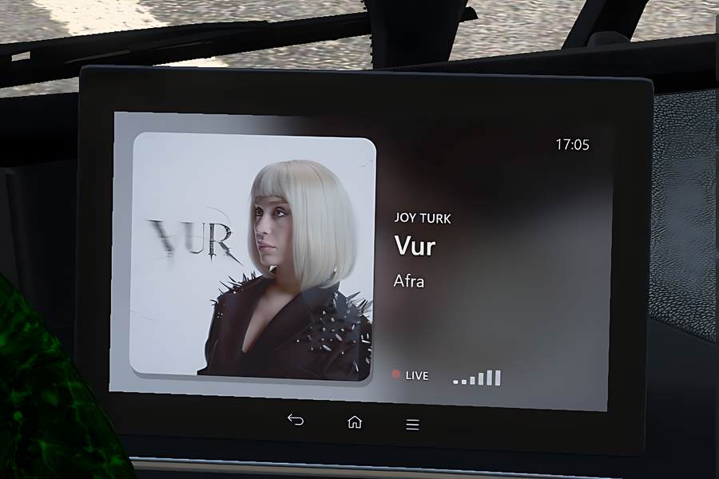
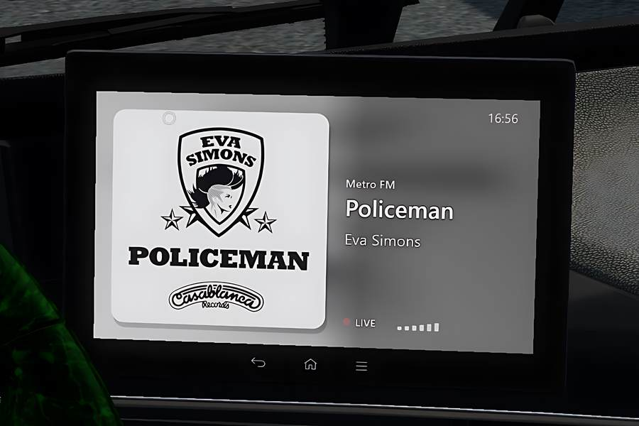

# EtsNowPlaying

**Sieh auf dem GPS-Display deines Trucks, was du gerade hörst** – in Euro Truck Simulator 2 und American Truck Simulator.
Das **Radio** im Spiel (Sender, Song, Interpret, Cover) oder **Spotify** (Cover, Titel, Interpret, Fortschritt), und du kannst
direkt in der Kabine auf Zurück / Pause / Weiter klicken.

*[English](README.md) · Deutsch*

> **Hinweis zum Fork:** Dieser Fork gibt dem Radio-Display ein neues Aussehen – größeres Cover, größerer und besser lesbarer Text.
> Siehe [Was in diesem Fork anders ist](#was-in-diesem-fork-anders-ist). Alles andere ist unverändert vom Original.

<p align="center">
  
  
</p>

## Das bekommst du

- **Radio:** Song, Interpret und Cover des Senders, den du im Spielradio hörst, dazu das Logo des Senders.
- **Spotify:** Cover, Titel, Interpret, Album, Fortschrittsbalken und Play/Pause – aus der Windows-Mediensteuerung,
  Spotify kann also im Hintergrund bleiben.
- **Schaltet selbst um:** Radio an → Radio, Radio aus → Spotify.
- **Klicken zum Steuern:** Zurück, Play/Pause und Weiter gehen mit der Maus, direkt auf dem Display. Auf den Fortschrittsbalken
  klicken oder ihn ziehen, um im Song vor- und zurückzuspulen.
- **Passt in jede Kabine:** Das Bild passt sich selbst an die Form des Displays jedes Fahrzeugs an – nichts pro Truck einstellen.
- **Eine Datei.** Nichts weiter zu installieren. Funktioniert mit TruckersMP.

## Was in diesem Fork anders ist

Dies ist ein Fork von [jxhnch/EtsNowPlaying](https://github.com/jxhnch/EtsNowPlaying) (MIT). **Geändert wurde nur das Aussehen
des Radio-Displays** (`src/renderer.cpp`). Radioerkennung, Cover, Spotify, die Touch-Tasten und alle Einstellungen sind
unverändert vom Original, und die Änderungen stehen unter derselben MIT-Lizenz.

<p align="center">
  
  
</p>
<p align="center"><em>Original (links) · dieser Fork (rechts)</em></p>

- **Größeres Cover, größerer Text:** Das Cover füllt fast die ganze Höhe des Displays. Daneben, vertikal zentriert: der
  Sendername (klein, in der Akzentfarbe des Covers), der Song (groß) und der Interpret.
- **Der Text passt:** Lange Titel und Interpreten werden umgebrochen (bis zu 3 bzw. 2 Zeilen) und auf etwa 70 % verkleinert,
  bevor sie abgeschnitten werden.
- **Auch auf hellen Covern lesbar:** Der Text hat einen dunklen Rand und einen weichen Schatten, und hinter der Textspalte
  blendet ein dunkler Schleier ein. Cover und unscharfer Hintergrund links bleiben hell und farbig.
- **Untere Zeile:** ein pulsierender roter Punkt, `LIVE` und ein kleiner Equalizer. Sie ersetzt die rote `LIVE`-Anzeige samt `RADIO`-Beschriftung
  oben und die Zeile mit Genre / Land / Bitrate.
- **Bessere Cover-Treffer:** Beim Vergleichen von Namen werden Akzente und türkische Buchstaben ignoriert (`COK` = `Çok`, `TATLISES` = `Tatlıses`), und iTunes wird zuerst
  im Store des Senders gefragt (`[radio] cover_country`). Sender mit Titeln in Großbuchstaben ohne Sonderzeichen finden jetzt ihre Cover.
- Das Spotify-Display ist unverändert.

**DLL dieses Forks holen:** Jeder Push wird von GitHub Actions gebaut ([`build.yml`](.github/workflows/build.yml)). Öffne den
neuesten Lauf im Reiter **Actions** und lade das Artefakt **`EtsNowPlaying-DLL`** herunter (ein Zip mit `EtsNowPlaying.dll`),
dann wie unten beschrieben installieren.

## Installieren

1. Spiel beenden.
2. **`EtsNowPlaying.dll`** von der Seite [Releases](../../releases) herunterladen.
3. In den `plugins`-Ordner des Spiels legen:  
   `...\Steam\steamapps\common\Euro Truck Simulator 2\bin\win_x64\plugins\`
4. Spiel starten, Profil laden und in die Kabine setzen. Das neue Display ersetzt das GPS.  
   Siehst du noch das normale GPS, starte das Spiel einmal neu (das Plugin richtet sich beim ersten Start selbst ein).

Entferne vorher andere Plugins, die das GPS-Display verändern, sie würden sich gegenseitig stören.

## Benutzen

- **Spotify:** einfach etwas abspielen.
- **Radio:** im Spiel das Radio einschalten. Die Songtitel kommen aus dem Radio-Stream selbst, einige Sender, die keine Titel
  senden, zeigen deshalb nur ihren Namen.
- **Tasten:** Bei sichtbarem Mauszeiger in der Kabine (rechte Maustaste nicht gedrückt) auf dem Display ⏮ ⏯ ⏭ anklicken.
  Auf den Fortschrittsbalken klicken oder ziehen, um zu spulen (Spotify).

## Einstellungen

`Dokumente\Euro Truck Simulator 2\EtsNowPlaying\EtsNowPlaying.ini` wird beim ersten Start angelegt:

| Einstellung | Standard | |
|---|---|---|
| `[screen] flip_vertical` | `1` | Auf `0` setzen, wenn das Bild kopfsteht. (Nur bei `auto_fit=0`.) |
| `[screen] auto_fit` | `1` | Bild an das Display jedes Fahrzeugs anpassen. `0` = aus. |
| `[media] app_filter` | `spotify` | Nur diese App zeigen. Leer = jeder Mediaplayer. |
| `[radio] cover_lookup` | `1` | Song-Cover und Sender-Logos online suchen. `0` = aus. |
| `[radio] cover_country` | `auto` | iTunes-Store, der für Cover zuerst gefragt wird: `auto` = Land des Senders aus `live_streams.sii` (z. B. `TR`), `none` = nur Standard-Store, oder ein Ländercode. Andere Kataloge werden danach immer versucht. |
| `[radio] extra_sources` | `1` | Die optionale Datei `EtsNowPlaying.sources.ini` benutzen (siehe unten). `0` = nie. |
| `[touch] enabled` | `1` | Maus-Tasten auf dem Display. `0` = aus. |

## Optional: zusätzliche Song-Quellen

Manche Sender senden in ihrem Stream nur den Namen einer *Show*, nicht den Song (Real Hardstyle Radio macht das während seiner
Shows). Bietet so ein Sender den aktuellen Song zusätzlich unter einer Web-Adresse an, kann man ihn in
`Dokumente\Euro Truck Simulator 2\EtsNowPlaying\EtsNowPlaying.sources.ini` eintragen. Das Plugin legt diese Datei beim ersten Start an,
**sie ist optional** und enthält einen Eintrag für Real Hardstyle Radio. Pro Eintrag gibst du an, woran man den Sender erkennt
(`match`), wo gefragt wird (`url`) und wo in der Antwort der Song steht (`title`, optional `artist`):

```ini
[Real Hardstyle]
enabled=1
match=realhardstyle|real hardstyle
url=https://api.realhardstyle.com/get/nowplaying
title=response.activeSession.rawTitle
interval=10
```

Das Plugin fragt diese Adresse nur, solange der Sender läuft (standardmäßig alle 10 Sekunden). Liefert sie keinen Song oder ist sie
nicht erreichbar, bleibt es beim Titel aus dem Stream. Mit `enabled=0` schaltest du einen Eintrag ab, mit `extra_sources=0` in der
INI alles.

## Datenschutz

Kein Tracking, keine Konten. Mit `cover_lookup=1` sendet das Plugin den aktuellen Radio-*Titel* und den *Sendernamen*
(und, um den richtigen iTunes-Store zu fragen, den Ländercode des Senders aus deiner Senderliste) an iTunes, Deezer und radio-browser.info, um ein Cover oder Logo zu finden. Sonst verlässt nichts deinen PC. Mit `0` schaltest du das ab.
Die optionale Quellen-Datei (siehe oben) bewirkt, dass das Plugin zusätzlich die dort eingetragene Web-Adresse fragt, solange dieser
Sender läuft; diese Adresse sieht deine IP-Adresse wie jede Webseite. `extra_sources=0` schaltet das ab.

## Probleme?

Das Plugin schreibt `Dokumente\Euro Truck Simulator 2\EtsNowPlaying\diag.log`. Wenn du ein Problem meldest, hänge sie bitte an.

**Nach einem Spiel-Update:** Eine neue Spielversion kann etwas verschieben, worauf das Plugin sich stützt. Dann lässt das Plugin das
normale GPS des Spiels in Ruhe (oder schaltet es wieder ein) und sagt es dir mit einem kleinen Fenster (einmal pro Spielversion). Schau auf der [Releases](../../releases)-Seite nach einem Plugin-Update; gibt es noch keins, eröffne bitte ein Issue und
hänge die Log-Datei an.

## Selbst bauen

Du brauchst die Visual Studio 2022 Build Tools (C++). `build.bat` ausführen; das Plugin ist `build\EtsNowPlaying.dll`.
Enthalten: [MinHook](https://github.com/TsudaKageyu/minhook) und die SCS-SDK-Header, siehe
[THIRD_PARTY_NOTICES.md](THIRD_PARTY_NOTICES.md).

## Hinweis

Nicht verbunden mit SCS Software, TruckersMP, Spotify, Apple oder Deezer. Das Plugin ändert Spielcode im Speicher – Nutzung auf
eigenes Risiko, und beachte die Regeln der Server, auf denen du spielst.

## Datenschutz & Nutzungsbedingungen

**Datenschutz.** EtsNowPlaying hat keine Konten, keine Analyse und keine eigene Telemetrie. Es liest den Radio-Stream des Spiels und
die Windows-Mediensteuerung auf deinem PC aus. Mit `[radio] cover_lookup=1` (Standard) sendet es den **aktuellen Radio-Songtitel,
den Sendernamen und den Ländercode des Senders (aus deiner Senderliste)** an **iTunes Search (Apple), Deezer und radio-browser.info**, um ein Cover oder Logo zu finden; wie bei jeder
Web-Anfrage sehen diese Dienste deine IP-Adresse. Sonst wird nichts gesendet: keine persönlichen Daten, keine Spieldaten, keine
Spotify-Daten. Mit `cover_lookup=0` sind alle Online-Anfragen aus. Logos werden in
`Dokumente\Euro Truck Simulator 2\EtsNowPlaying\logos` zwischengespeichert, und `diag.log` bleibt auf deinem PC, solange du sie nicht selbst
verschickst. Ist ein Eintrag der optionalen Datei `EtsNowPlaying.sources.ini` aktiv (einer für Real Hardstyle Radio ist enthalten), fragt das
Plugin zusätzlich die dort eingetragene Web-Adresse alle paar Sekunden ab, aber nur, solange dieser Sender läuft; die Anfrage enthält keine
Daten über dich, der Server sieht deine IP-Adresse. Mit `[radio] extra_sources=0` oder `enabled=0` schaltest du das ab.

**Bedingungen.** Freie Software unter der [MIT-Lizenz](LICENSE), „wie besehen“ und ohne Gewähr. Das Plugin verändert Spielcode im
Speicher: Nutzung auf eigenes Risiko, und die Regeln der Server, auf denen du spielst (z. B. TruckersMP), gelten weiter. Cover und
Logos gehören ihren Rechteinhabern und werden nur angezeigt, nicht darüber hinaus gespeichert (außer dem Logo-Cache); für deren Daten
gelten die Bedingungen von iTunes, Deezer und radio-browser.info. Keine Verbindung zu SCS Software, TruckersMP, Spotify, Apple oder Deezer.

[MIT-Lizenz](LICENSE)
